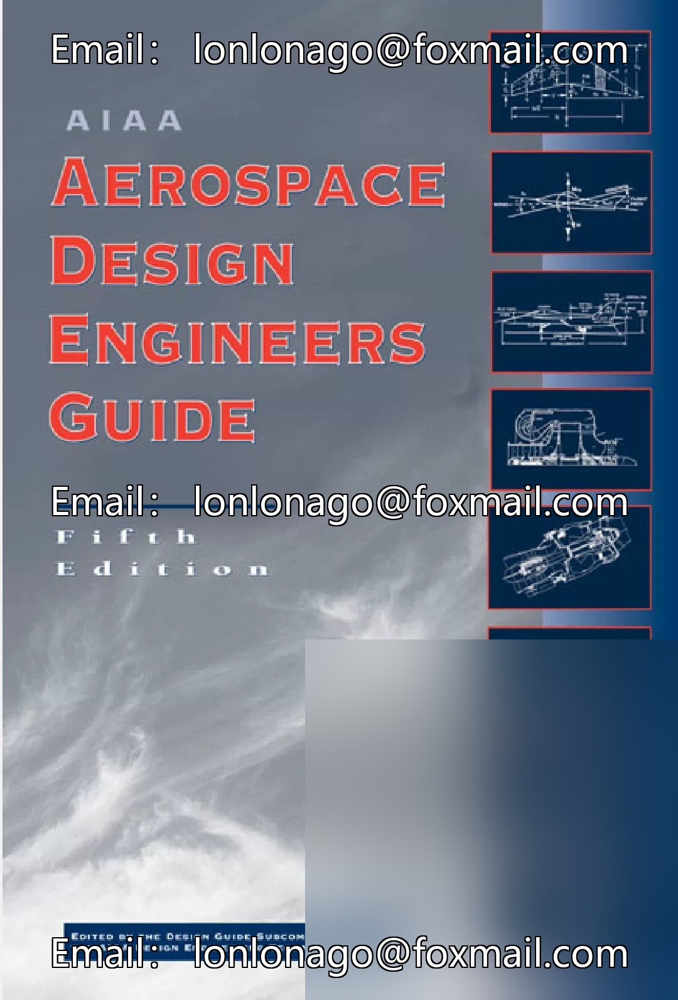
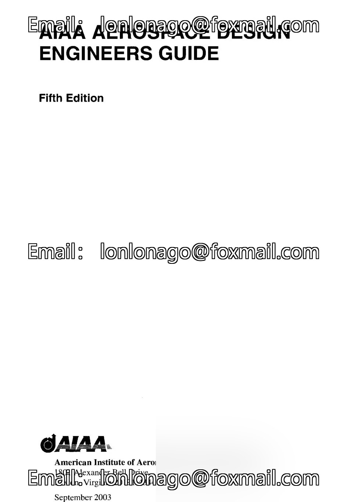

# AIAA Aerospace Engineering Guide (Fifth Edition)

## Body

Guide to AIAA Aerospace Design Engineers (Fifth Edition), published in September 2003 by the American Institute of Aeronautics and Astronautics.
1. Core Content Analysis
1. Manual Nature and Purpose
Official publication of AIAA (American Institute of Aeronautics and Astronautics, American Institute of Aeronautics and Astronautics) for the Fifth Edition, comprehensively covering the field of aerospace engineering design.
2. Content Characteristics
- Basic knowledge of aerospace design
- Design specifications for various aircraft
- Structural design and analysis
- Powerplant design
- Control system design
- Experimental and testing methods
- Engineering calculations and formulas
3. Technical Depth

Manual adopts substantial data and charts, deeply and superficially introduces the core content of aerospace engineering design, suitable for reference and use by engineers engaged in aerospace engineering design.
2. Historical background
AIAA was established in 1930, one of the largest aerospace professional societies in the world.
As an important technical guide of the society, this manual plays an important role in aerospace engineering education and practice.
3. Technical details
The manual is rich in content, with abundant text and images, containing a large number of design examples and engineering cases, and is an important reference material for aerospace engineering design.

The guide covers aerospace design engineer topics such as design fundamentals, aircraft specifications, structural analysis, power devices, control systems, testing methods, and engineering calculations, with the AIAA background, publication details, technical details and design examples listed.

<!-- AI_ENRICHED -->

## Images

## Payment

Here is a pay link on Stripe ( https://buy.stripe.com/3cs8yP7sY87d0vu9AB ). Please contact me lonlonago@foxmail.com after funding $89, and I will send you a complete data files , thank you!

